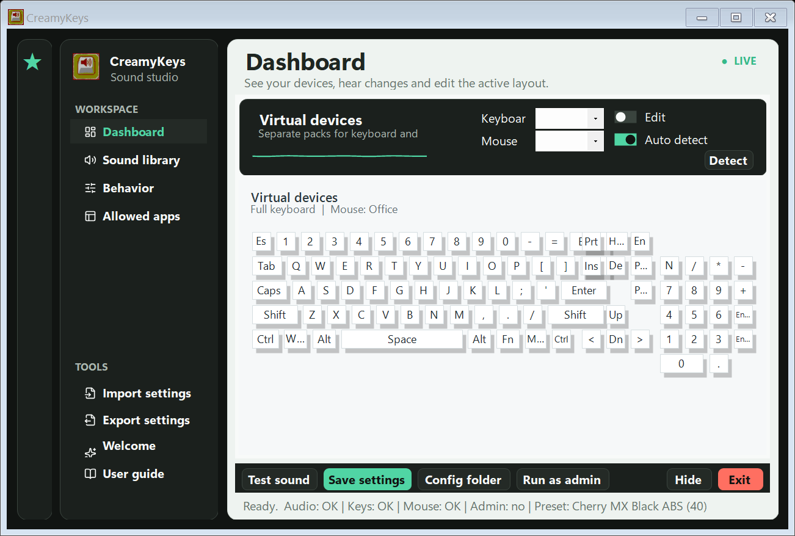

# CreamyKeys

CreamyKeys brings CreamyKeys-style keyboard and mouse ASMR sounds from Minecraft to normal Windows desktop apps and games.



## Download

Download the latest portable build from the GitHub Releases page:

- `CreamyKeys-portable.zip` - recommended portable package
- `CreamyKeys.exe` - standalone app executable

Extract the zip, then run `CreamyKeys.exe`.

Watch the 18-second 1080p product trailer from the latest Release:

- `CreamyKeys-trailer-v1.2.0.mp4` - interface preview with native CreamyKeys key and mouse sounds

## Quick Start

1. Run `CreamyKeys.exe`.
2. Follow the welcome pop-up, or reopen it later from **Welcome pop-up** in the sidebar.
3. Open the **Sound library** page and make sure **App enabled**, **Keyboard sound**, and **Mouse sound** are enabled.
4. Pick keyboard and mouse presets, adjust **Keyboard volume**, **Mouse volume**, and **Key boost**, then press **Test sound**.
5. Open **Dashboard** to see the virtual keyboard and mouse.
6. Press **Save settings** after changing settings.
7. Use **Hide** to keep the app running in the tray.

If a game runs as administrator, run CreamyKeys as administrator too.

## Features

- Global keyboard sound for desktop apps and many games.
- Global mouse click sound, including left, right, middle, X1, and X2 buttons.
- No-repeat shuffle playback: samples cycle in a shuffled order and do not immediately repeat between cycles.
- Independent keyboard and mouse shuffle pools, presets, volume, and layering.
- Separate mouse preset and mouse layers, matching the mod's secondary sound-pack behavior.
- CreamyKeys sound presets extracted from the Minecraft mod assets.
- Volume and pitch variation on every trigger for a less static sound.
- Tray menu with settings, enable/disable, test sound, startup, admin, and exit actions.
- Startup loading screen, optional welcome pop-up, built-in user guide, and a live curved sound waveform.
- Smooth slide page transitions, a moving sidebar indicator, animated toggles, buttons, and sliders, with a reduced-motion option.
- Virtual keyboard that lights up when you press physical keys.
- Virtual mouse that lights up when you click physical mouse buttons.
- Keyboard layouts: laptop, 60%, tenkeyless, and full size.
- Mouse styles: office, gaming, and compact.
- Auto-detect option to choose a matching keyboard and mouse style from Windows device names.
- Per-key and per-button customization in edit mode or by right-clicking a virtual button.
- Custom label, icon text, position offset, and custom `.wav` sound for each virtual key/button.
- Keyboard volume, mouse volume, key boost, variation, cooldown, and max voice controls.
- Behavior settings for held key repeat, modifier keys, injected input, and startup.
- Installed-app scanner with app names, executable names, logos, search, and foreground-app capture.
- App allow list: checked apps are allowed to play CreamyKeys sounds, unchecked apps are blocked.
- Adjustable virtual device shadow: enable/disable, depth, and X/Y direction.
- Import and export complete settings as a portable JSON file.
- Lucide interface icons, selected from a set supported by Morphicons and bundled under the ISC license.

## Pages

### Dashboard

The Dashboard is the main view. It shows the virtual keyboard and, when enabled, the virtual mouse. You can select the keyboard layout and mouse style from the compact controls at the top.

Use **Auto detect** to let CreamyKeys choose the closest layout automatically.

### Sound Library

Sound settings live here:

- **App enabled** turns the whole app on or off.
- **Keyboard sound** enables key sounds.
- **Mouse sound** enables mouse sounds.
- **Show virtual mouse** shows or hides the virtual mouse.
- **Keyboard preset** selects the sound pack used by keyboard presses.
- **Mouse preset** selects the secondary sound pack used by mouse clicks.
- **Keyboard volume** controls keyboard sample volume.
- **Mouse volume** controls mouse sample volume independently.
- **Key boost** makes CreamyKeys louder relative to other apps.
- **Volume variation** and **Pitch variation** add small controlled differences on every trigger.

Most sliders also have a percentage box beside them, so you can type the exact value you want.

### Behavior

Use this page to tune how input is handled:

- **Held key repeat** plays sounds while holding a key.
- **Shift / Ctrl / Alt** allows modifier keys to make sound.
- **Ignore injected input** avoids playing sounds for synthetic input.
- **Run at startup** starts CreamyKeys with Windows.
- **Cooldown** limits how quickly repeated sounds can fire.
- **Max voices** limits overlapping sounds.
- **Keyboard layers** and **Mouse layers** stack 1-16 random samples per input, like the mod's amplify controls.
- **Reduce animations** keeps navigation immediate and disables decorative transitions.
- **Show welcome pop-up** controls whether the welcome screen appears at startup.

### Allowed Apps

Use this page to control where CreamyKeys works. Press **Scan** to discover installed desktop apps, Microsoft Store apps exposed through Windows App Paths, Start menu shortcuts, and currently open windows. Use the search box to find an app by display name or process name.

- Checked app: CreamyKeys can play sounds in that app.
- Unchecked app: CreamyKeys will stay silent in that app.
- **Current** adds the app currently in the foreground.
- **Add app** accepts a process name manually when an app cannot be discovered.

This is useful for excluding voice chat, recording apps, or apps where you do not want keyboard sounds.

## Tray Menu

CreamyKeys keeps running in the system tray when hidden. Right-click the tray icon for quick controls:

- Open settings
- Enable or disable
- Test sound
- Change preset, output volume, and key boost
- Toggle startup, key repeat, modifier keys, and injected input filtering
- Open config folder
- Run as administrator
- Exit

Double-click the tray icon to show the main window again.

## Import And Export Settings

Use **Export settings** in the sidebar to save the complete current configuration as JSON. The export includes sound packs, volume, behavior, virtual-device options, app rules, and per-button overrides.

Use **Import settings** to load that file on another computer or restore a previous setup. CreamyKeys validates and migrates older configuration versions before applying them.

After importing, review the selected sound packs if the destination computer has a different `assets` folder.

## Welcome Pop-up And User Guide

The welcome pop-up uses the CreamyKeys app icon and includes a **Do not show again** switch. You can re-enable it at any time from **Behavior > Show welcome pop-up**.

Open **User guide** in the sidebar for in-app instructions covering quick start, sound variation, behavior, allowed apps, tray controls, and settings transfer.

## How Sound Variation Works

The original mod chooses from multiple samples rather than playing a fixed click sequence. CreamyKeys mirrors that behavior with separate shuffled sample pools for keyboard and mouse input.

- Every available sample is used before the pool is shuffled again.
- The first sample of a new cycle cannot immediately repeat the last sample of the previous cycle.
- Pitch and volume variation add smaller differences without changing the selected preset.
- Layers can stack several samples for a heavier sound.
- The `hit` through `hit8` sound groups from the mod are included when available in the source jar.

## Custom Sounds

You can add or replace sounds in the `assets` folder.

Keyboard presets are stored in:

```text
assets\keyboards\<preset-name>\
```

Mouse sounds are stored in:

```text
assets\mouse\
```

For per-button custom sounds, enable edit mode or right-click a virtual key/button, then choose a `.wav` file.

## Config

User settings are saved here:

```text
%APPDATA%\CreamyKeysDesktop\config.json
```

A sample config is included as:

```text
config.example.json
```

## Build From Source

Requirements:

- Windows
- PowerShell
- .NET Framework C# compiler at `C:\Windows\Microsoft.NET\Framework64\v4.0.30319\csc.exe`
- Python, only needed when extracting assets from the Minecraft mod jar

Build:

```powershell
.\build.ps1
```

Build without re-extracting assets:

```powershell
.\build.ps1 -SkipAssets
```

Regenerate the bundled native PNG interface icons from their Lucide SVG sources:

```powershell
.\scripts\render_ui_icons.ps1
```

Use a custom CreamyKeys mod jar:

```powershell
.\build.ps1 -CreamyKeysJar "C:\path\to\CreamyKeys.jar"
```

Smoke test:

```powershell
.\dist\CreamyKeys.exe --smoke-test
```

Create the portable zip:

```powershell
Compress-Archive -Path "dist\*" -DestinationPath "CreamyKeys-portable.zip" -Force
```

## Troubleshooting

- **No sound:** check App enabled, Keyboard sound, Mouse sound, Windows volume, and both volume controls.
- **Sound too quiet:** increase Keyboard volume or Mouse volume and Key boost. Windows master volume still affects the final loudness.
- **Game does not trigger sounds:** run CreamyKeys as administrator if the game is elevated.
- **Some games block hooks:** anti-cheat or exclusive input modes may block global keyboard/mouse hooks.
- **Mouse is hidden:** enable Mouse sound and Show virtual mouse in the Sound Library page.
- **Settings are wrong:** open the config folder from the app or tray menu and remove `config.json` to reset.
- **Animations feel distracting:** enable Reduce animations on the Behavior page.
- **Moving to another PC:** export settings, copy the portable folder, then import the saved JSON file.

## Credits

Inspired by the CreamyKeys Minecraft mod.

Idea: CreamyKeys mod - Minecraft

Interface icons are from [Lucide](https://lucide.dev/) under the ISC license. Morphicons was used as the icon-set reference; its web animation runtime is not bundled into this native WinForms app.
